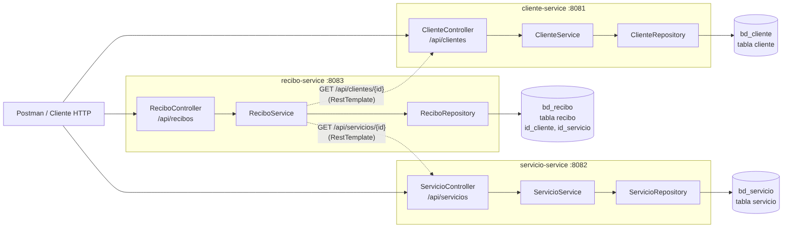

# Evaluación 03 – Gestión de pagos de servicios (Microservicios)

**Curso:** Desarrollo de Aplicaciones Web – 4 C24
**Estudiante:** Rojas Condor José Saith
**Laboratorio:** 18 – Gestión de pagos de servicios (Cliente, Servicio, Recibo)

Una empresa necesita controlar a sus clientes, los servicios que ofrece (luz, agua, internet, gas…) y los recibos que se generan cada mes. El sistema está dividido en **3 microservicios Spring Boot independientes**, cada uno con su propio puerto y su propia base de datos MySQL.



## Requisitos

| Herramienta | Versión |
|---|---|
| Java (JDK) | 17 o superior |
| Maven | 3.9+ (o el que trae IntelliJ) |
| Spring Boot | 3.5.6 |
| MySQL | 8.x (XAMPP / MySQL Server) |
| Postman | cualquier versión reciente |

Dependencias de cada proyecto (Spring Initializr): Spring Web, Spring Data JPA, MySQL Driver, Validation y Spring Boot DevTools.

## Microservicios, puertos y bases de datos

| Microservicio | Puerto | Base de datos | Responsabilidad |
|---|---|---|---|
| `cliente-service` | 8081 | `bd_cliente` | CRUD de clientes (DNI único, nombres, apellidos, correo, teléfono, dirección) |
| `servicio-service` | 8082 | `bd_servicio` | CRUD de servicios (nombre único, empresa, tarifa mensual, activo) |
| `recibo-service` | 8083 | `bd_recibo` | Recibos: idCliente, idServicio, periodo, monto, fechaVencimiento y estadoPago (PENDIENTE / PAGADO) |

- Ningún servicio comparte tablas. El recibo guarda solo `id_cliente` e `id_servicio` (sin FOREIGN KEY, porque están en otras bases).
- Antes de registrar o actualizar un recibo, `recibo-service` consulta por HTTP (RestTemplate) a `cliente-service` y `servicio-service` para comprobar que el cliente y el servicio existan.

## Estructura de cada proyecto

```
src/main/java/com/tecsup/<servicio>/
├── model/        -> entidades JPA (@Entity)
├── dto/          -> datos de entrada con validaciones (@NotBlank, @Positive, @Pattern...)
├── repository/   -> interfaces JpaRepository
├── services/     -> lógica de negocio
├── controller/   -> endpoints REST
└── exception/    -> excepciones propias + GlobalExceptionHandler
src/main/resources/
├── application.yml        -> nombre, puerto y perfil activo
├── application-dev.yml    -> configuración de desarrollo
└── application-prod.yml   -> configuración de producción
```

## Perfiles dev / prod

El perfil activo se elige en `application.yml` (`spring.profiles.active: dev`) o al ejecutar con `--spring.profiles.active=prod`.

| Valor | dev | prod |
|---|---|---|
| URL de la BD | `localhost:3306/bd_xxx` con `createDatabaseIfNotExist=true` | variable `DB_URL` |
| Usuario / contraseña | `root` / vacío (XAMPP) | variables `DB_USERNAME` y `DB_PASSWORD` (no están en el código) |
| `ddl-auto` | `update` (crea/actualiza las tablas solo) | `none` (usa las tablas del script SQL) |
| `show-sql` | `true` | `false` |
| Logs `com.tecsup` | `DEBUG` | `INFO` |
| URLs de otros servicios (solo recibo) | `http://localhost:8081` y `:8082` | variables `CLIENTE_SERVICE_URL` y `SERVICIO_SERVICE_URL` |

## Pasos de ejecución

1. Iniciar MySQL (por ejemplo desde XAMPP).
2. (Opcional en dev) Ejecutar `sql/script_bd.sql` en MySQL Workbench / phpMyAdmin para crear las 3 bases con datos de prueba. En **prod es obligatorio**.
3. Abrir cada carpeta (`cliente-service`, `servicio-service`, `recibo-service`) como proyecto Maven en IntelliJ.
4. Levantar en este orden: **ClienteServiceApplication** (8081), **ServicioServiceApplication** (8082) y **ReciboServiceApplication** (8083).
   Desde consola también se puede: `mvn spring-boot:run` dentro de cada carpeta.
5. Importar en Postman `postman/Evaluacion03-PagosServicios.postman_collection.json` y ejecutar las peticiones en orden (o todas con el *Collection Runner*). Los IDs creados se guardan solos en variables.

Para correr en prod (PowerShell):

```powershell
$env:DB_USERNAME="usuario"; $env:DB_PASSWORD="clave"
mvn spring-boot:run "-Dspring-boot.run.profiles=prod"
```

## Endpoints

### cliente-service – `http://localhost:8081/api/clientes`

| Método | Ruta | Descripción | Respuesta |
|---|---|---|---|
| GET | `/api/clientes` | Listar clientes | 200 |
| GET | `/api/clientes/{id}` | Buscar por ID | 200 / 404 |
| POST | `/api/clientes` | Registrar cliente | 201 / 400 / 409 (DNI repetido) |
| PUT | `/api/clientes/{id}` | Actualizar cliente | 200 / 400 / 404 / 409 |
| DELETE | `/api/clientes/{id}` | Eliminar cliente | 204 / 404 |

### servicio-service – `http://localhost:8082/api/servicios`

| Método | Ruta | Descripción | Respuesta |
|---|---|---|---|
| GET | `/api/servicios` | Listar servicios | 200 |
| GET | `/api/servicios/{id}` | Buscar por ID | 200 / 404 |
| POST | `/api/servicios` | Registrar servicio | 201 / 400 / 409 (nombre repetido) |
| PUT | `/api/servicios/{id}` | Actualizar servicio | 200 / 400 / 404 / 409 |
| DELETE | `/api/servicios/{id}` | Eliminar servicio | 204 / 404 |

### recibo-service – `http://localhost:8083/api/recibos`

| Método | Ruta | Descripción | Respuesta |
|---|---|---|---|
| GET | `/api/recibos` | Listar recibos | 200 |
| GET | `/api/recibos/{id}` | Buscar por ID | 200 / 404 |
| GET | `/api/recibos/cliente/{idCliente}` | Recibos de un cliente | 200 |
| GET | `/api/recibos/estado/{estado}` | Filtrar por `PENDIENTE` o `PAGADO` | 200 / 400 |
| POST | `/api/recibos` | Registrar recibo (nace `PENDIENTE`) | 201 / 400 / 404 / 409 / 503 |
| PUT | `/api/recibos/{id}` | Actualizar recibo (solo si está `PENDIENTE`) | 200 / 400 / 404 / 409 |
| PATCH | `/api/recibos/{id}/pagar` | Marcar como `PAGADO` (guarda fecha de pago) | 200 / 400 / 404 |
| DELETE | `/api/recibos/{id}` | Eliminar recibo | 204 / 404 |

Ejemplo de body para registrar un recibo:

```json
{
  "idCliente": 1,
  "idServicio": 1,
  "periodo": "2026-11",
  "monto": 120.50,
  "fechaVencimiento": "2026-11-30"
}
```

## Validaciones y reglas del negocio

- **Monto positivo** (`@Positive`) y **periodo obligatorio** con formato `AAAA-MM` (`@NotBlank` + `@Pattern`).
- `idCliente`, `idServicio` y `fechaVencimiento` obligatorios; la fecha de vencimiento no puede ser anterior a la fecha de emisión.
- El cliente y el servicio deben existir en sus microservicios (404 si no existen, 503 si el servicio está apagado); el servicio debe estar activo.
- Un cliente no puede tener dos recibos del mismo servicio en el mismo periodo (409).
- Todo recibo nuevo empieza en `PENDIENTE`; con `PATCH /pagar` pasa a `PAGADO`. Un recibo pagado no se puede volver a pagar ni modificar (400).
- Cliente: DNI de 8 dígitos y único, correo válido, teléfono de 9 dígitos que empieza con 9.
- Servicio: nombre único y tarifa mensual mayor a 0.

## Formato de errores

Todos los errores los maneja `GlobalExceptionHandler` y devuelven JSON:

```json
{ "error": "Recibo no encontrado con id 99999" }
```

Errores de validación (400), un mensaje por campo:

```json
{
  "periodo": "El periodo es obligatorio",
  "monto": "El monto debe ser mayor a 0"
}
```

| Código | Cuándo |
|---|---|
| 400 | Datos inválidos, JSON mal formado, ID no numérico, estado no válido, recibo ya pagado |
| 404 | ID inexistente (o cliente/servicio inexistente al registrar un recibo) |
| 409 | DNI, nombre de servicio o recibo del mismo periodo repetido |
| 503 | `recibo-service` no puede comunicarse con `cliente-service` o `servicio-service` |

## Archivos de entrega

- `cliente-service/`, `servicio-service/`, `recibo-service/` – código fuente
- `sql/script_bd.sql` – creación de las 3 bases de datos con datos de prueba
- `postman/Evaluacion03-PagosServicios.postman_collection.json` – 42 peticiones (casos exitosos y de error)
- `docs/diagrama-microservicios.png` – diagrama de microservicios y bases de datos
